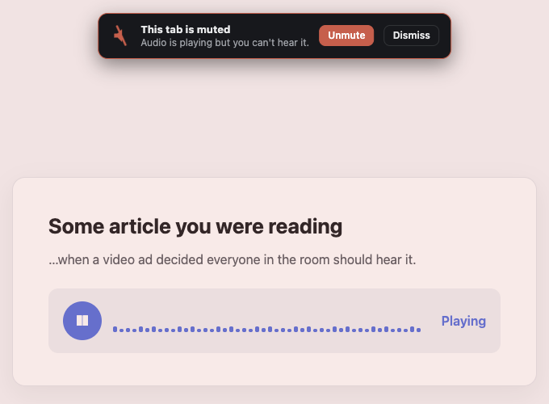
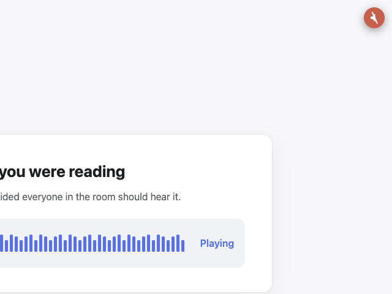
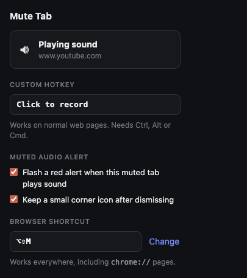
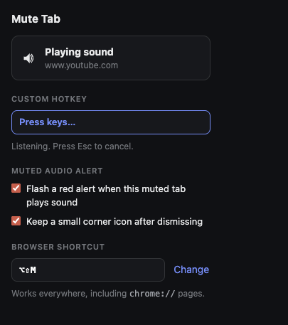
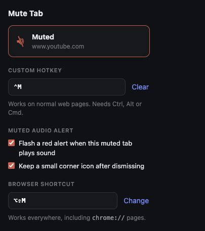

<h1 align="center">
  <br>
  Mute Tab
</h1>

<p align="center">
  <b>Silence everything in the current tab with one keystroke.</b><br>
  Press <kbd>Alt</kbd> + <kbd>Shift</kbd> + <kbd>M</kbd> to toggle mute, or record your own combination.
</p>

<p align="center">
  
  
</p>

---

## In action

<p align="center">
  
  
</p>
<p align="center">
  <sub>A muted tab starts playing sound: the page tints red and a flashing banner offers <b>Unmute</b> and
  <b>Dismiss</b> — dismissed, it collapses to a small corner icon (click it to unmute).</sub>
</p>

<p align="center">
  
  
  
</p>
<p align="center">
  <sub>The popup: current tab state, hotkey recorder (idle · recording · recorded), the muted-audio
  alert toggles, and the browser shortcut.</sub>
</p>

## Why

Chrome can mute a tab, but only by right-clicking it. That is a poor fit for the
one case where it matters — an ad or autoplay video starting mid-sentence. This
makes it a keystroke, and mutes at the browser level so it catches *everything*
in the tab: `<video>`, `<audio>`, Web Audio, and audio inside cross-origin iframes.

## Two hotkeys, on purpose

| | Browser shortcut | Custom hotkey |
| --- | --- | --- |
| Default | <kbd>Alt</kbd> + <kbd>Shift</kbd> + <kbd>M</kbd> | none until you record one |
| Set from | `chrome://extensions/shortcuts` | the extension popup |
| Works on `chrome://` pages, the PDF viewer, the new tab page | yes | no |
| Needs the page to have focus | no | yes |

Chrome does not let an extension assign its own global shortcut, so the browser
shortcut can only be rebound on Chrome's own shortcuts page — the popup has a
**Change** button that opens it. The custom hotkey fills the gap: it is recorded
in the popup and handled by a content script, which is why it cannot reach
`chrome://` pages.

Both routes call the same code, so the toolbar icon and badge stay in sync no
matter which one you use.

## How it behaves

- **Mutes at the tab level.** Uses `chrome.tabs.update({ muted })` rather than
  hunting for media elements, so nothing in the tab can slip through.
- **Shows state in the toolbar.** The icon turns into a red slashed speaker and
  picks up an `OFF` badge. Chrome resets per-tab icons on navigation, so it is
  repainted whenever a tab finishes loading.
- **Fires even while you're typing.** Chrome's command shortcuts work with focus
  in a text field, and the custom hotkey matches that. It is also why a Ctrl, Alt,
  or Cmd modifier is required, and why the keystroke is swallowed so it cannot
  insert a stray character.
- **Wins against pages that hijack keys.** The key handler runs in the capture
  phase and in every frame, so it fires before page-level handlers.
- **Survives navigation and restarts.** Mute state lives on the tab itself, so
  there is nothing to persist and nothing to get out of sync.
- **Requires no host permissions.** Tab muting needs none, and `activeTab` covers
  reading the hostname shown in the popup.
- **Warns when a muted tab plays sound.** Chrome keeps a tab's `audible` flag on
  while a muted tab is still trying to play, so the page gets a red tint and a
  flashing mute banner with **Unmute** and **Dismiss** buttons. Dismissing
  collapses it to a small flashing icon in the top-right corner (click it to
  unmute). Both the alert and the corner icon can be turned off in the popup.

Muting is manual only — nothing is auto-muted and no per-site rules are stored.

## Install

1. Clone or download this repo
2. Open `chrome://extensions`
3. Enable **Developer mode** (top right)
4. Click **Load unpacked** and select the project folder
5. Reload any tabs you had open, so the custom hotkey works there too

The browser shortcut is active immediately. To record a custom hotkey, click the
toolbar icon, click the hotkey field, and press your combination — it must include
Ctrl, Alt, or Cmd so it cannot collide with normal typing.

## Project layout

| File | Purpose |
| --- | --- |
| `manifest.json` | MV3 manifest — the `toggle-mute` command, content script, `storage` + `activeTab` |
| `background.js` | Service worker: the mute logic, toolbar icon, badge, tooltip, and muted-audio detection |
| `content.js` | Listens for the recorded hotkey and draws the muted-audio alert |
| `popup.html` / `popup.css` / `popup.js` | Mute toggle, hotkey recorder, alert settings, link to Chrome's shortcuts page |
| `icons/*.png` | Speaker (`icon*.png`) and muted speaker (`muted*.png`) at 16 / 32 / 48 / 128 |
| `tools/make_icons.py` | Renders the icon PNGs |
| `screenshots/*.png` | The images in this README |

Regenerate the icons after editing the geometry constants in the script:

```bash
python3 tools/make_icons.py
```

It draws the glyph into a supersampled buffer and writes the PNGs directly, so it
needs only the Python standard library. The slash is deliberately steep — a 45°
slash runs parallel to the speaker cone's edges and dissolves the silhouette at
16 px.

## A note on the permission warning

Chrome will warn that this extension can "read and change all your data on all
websites." That comes from the `<all_urls>` content script, which only listens
for the recorded key combination and draws the muted-audio alert — it reads no
page content and makes no network calls. Delete the `content_scripts` block from
`manifest.json` if you would rather use only the browser shortcut; everything
else keeps working, minus the alert.

## Compatibility

Chrome and other Chromium browsers (Edge, Brave, Arc) with Manifest V3 support.

## License

MIT
